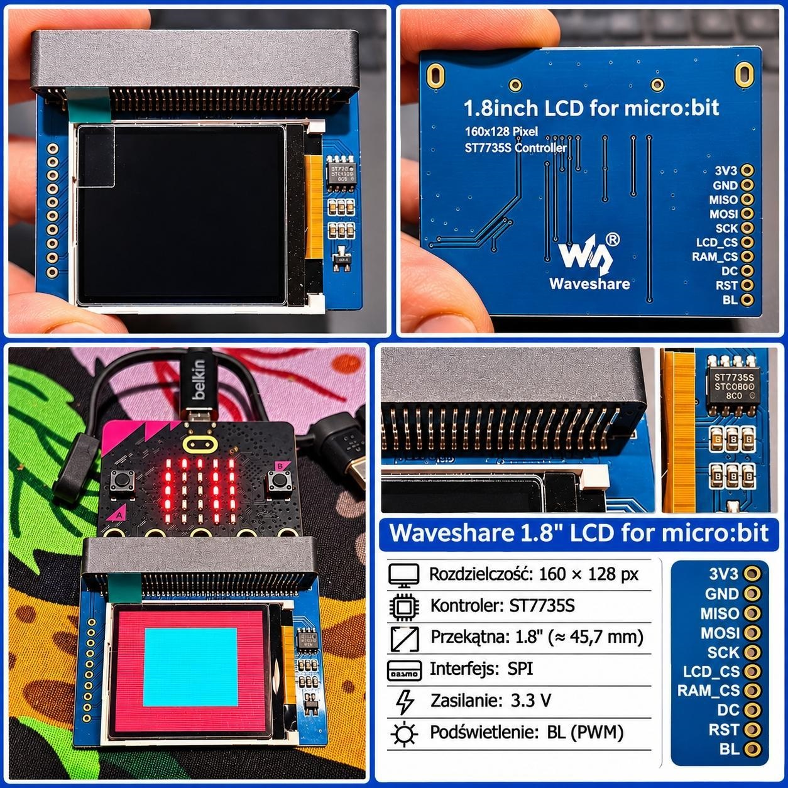

# Fast ST7735S LCD for BBC micro:bit

Fast graphics library for the **Waveshare 1.8-inch Colorful Display Module for micro:bit**, featuring a 160 × 128 pixel ST7735S TFT display and onboard 23LC1024 SRAM.

Designed for **BBC micro:bit V2** and **Microsoft MakeCode**.



## Features

- Fast SPI communication, tested at 32 MHz.
- 160 × 128 pixel color graphics.
- RGB565 color format (65,536 colors).
- Direct drawing to the LCD.
- Off-screen drawing using external SRAM.
- Three independent framebuffers stored in SRAM.
- Full-screen refresh using `show()`.
- Partial-screen refresh using `showChanged()`.
- Drawing pixels, lines, rectangles and circles.
- Adjustable SPI speeds for LCD and SRAM.
- Support for MakeCode JavaScript and graphical blocks.

## Hardware

The library is designed for the Waveshare 1.8-inch Colorful Display Module for micro:bit.

| Component | Specification |
|---|---|
| Display controller | ST7735S |
| Display size | 1.8 inches |
| Resolution | 160 × 128 pixels |
| Color format | RGB565 |
| External memory | 23LC1024 SRAM |
| SRAM capacity | 128 KiB |
| Interface | SPI |
| Microcontroller | BBC micro:bit V2 |

## Pin connections

The default pin configuration is:

| Function | micro:bit pin |
|---|---|
| LCD MOSI | P15 |
| LCD MISO / SRAM MISO | P14 |
| LCD SCK | P13 |
| LCD CS | P16 |
| LCD DC | P12 |
| LCD RST | P8 |
| SRAM CS | P2 |

The LCD and SRAM share the SPI bus and use separate chip-select signals.

The default pins can be changed using `setPins()` and `setSPIPins()`.

## Installation

1. Open Microsoft MakeCode for micro:bit.
2. Create a new project.
3. Open **Extensions**.
4. Enter the GitHub repository address:

   `https://github.com/pawelkasprowicz/pxt-fast-st7735s`

5. Select the extension.

## Quick start

```typescript
fastLCD.init()

fastLCD.setLCDSpeed(fastLCD.Speed.MHz32)

fastLCD.drawTo(fastLCD.DrawTarget.LCD)

fastLCD.clear(0x0000)

fastLCD.fillRect(10, 10, 140, 30, 0xF800)
fastLCD.fillRect(10, 50, 140, 30, 0x07E0)
fastLCD.fillRect(10, 90, 140, 30, 0x001F)
```

This example displays three colored rectangles.

## SRAM framebuffer

The onboard 23LC1024 SRAM provides 128 KiB of external memory.

One complete RGB565 image requires:

`160 × 128 × 2 = 40,960 bytes`

The memory can therefore hold three complete images:

`3 × 40,960 = 122,880 bytes`

The remaining 8,192 bytes are not used by the framebuffer system.

### Drawing to SRAM

```typescript
fastLCD.init()

fastLCD.selectFrame(0)

fastLCD.drawTo(fastLCD.DrawTarget.SRAM)

fastLCD.clear(0x0000)

fastLCD.fillRect(20, 20, 100, 50, 0xF800)

// Transfer the completed image to the LCD
fastLCD.show()
```

Graphics are prepared in external memory and displayed only when `show()` is called.

## Three independent images

```typescript
fastLCD.init()

// Frame 0
fastLCD.selectFrame(0)
fastLCD.drawTo(fastLCD.DrawTarget.SRAM)
fastLCD.clear(0xF800)

// Frame 1
fastLCD.selectFrame(1)
fastLCD.drawTo(fastLCD.DrawTarget.SRAM)
fastLCD.clear(0x07E0)

// Frame 2
fastLCD.selectFrame(2)
fastLCD.drawTo(fastLCD.DrawTarget.SRAM)
fastLCD.clear(0x001F)

// Display frame 0
fastLCD.selectFrame(0)
fastLCD.show()

input.onButtonPressed(Button.A, function () {
    fastLCD.selectFrame(1)
    fastLCD.show()
})

input.onButtonPressed(Button.B, function () {
    fastLCD.selectFrame(2)
    fastLCD.show()
})
```

## Partial screen refresh

Use `showChanged()` to update the modified region of the framebuffer.

```typescript
fastLCD.init()

fastLCD.selectFrame(0)
fastLCD.drawTo(fastLCD.DrawTarget.SRAM)

fastLCD.clear(0x0000)
fastLCD.show()

input.onButtonPressed(Button.A, function () {
    fastLCD.fillRect(20, 20, 50, 30, 0xF800)
    fastLCD.showChanged()
})
```

This can reduce the amount of data transferred to the display when only a small area changes.

## Available functions

| Function | Description |
|---|---|
| `init()` | Initialize LCD and SRAM |
| `setLCDSpeed()` | Set LCD SPI frequency |
| `setSRAMSpeed()` | Set SRAM SPI frequency |
| `setPins()` | Configure LCD and SRAM control pins |
| `setSPIPins()` | Configure SPI pins |
| `drawTo()` | Select LCD or SRAM drawing |
| `selectFrame()` | Select framebuffer 0, 1 or 2 |
| `clear()` | Fill the selected drawing target with a color |
| `pixel()` | Draw a pixel |
| `line()` | Draw a line |
| `rect()` | Draw a rectangle outline |
| `fillRect()` | Draw a filled rectangle |
| `circle()` | Draw a circle outline |
| `show()` | Display the complete SRAM framebuffer |
| `showChanged()` | Display the modified framebuffer region |
| `rgb()` | Convert RGB888 components to RGB565 |

## Performance

Measurements obtained during development using BBC micro:bit V2:

| Operation | Measured time |
|---|---:|
| Direct LCD transfer, 40,960 bytes at 32 MHz | Approximately 13 ms |
| SRAM-to-LCD full-frame transfer at 8 MHz | Approximately 88 ms |
| SRAM-to-LCD full-frame transfer at 16 MHz | Approximately 48 ms |
| SRAM-to-LCD full-frame transfer at 32 MHz | Approximately 27 ms |

These are development test measurements. Actual performance depends on the drawing operations, buffer handling and application code.

## Notes

- The library uses a fixed resolution of 160 × 128 pixels.
- Each framebuffer occupies 40,960 bytes.
- Supported framebuffer indices are 0, 1 and 2.
- The library uses RGB565 colors.
- The default SPI speed is 32 MHz.
- The current version focuses on graphics primitives and framebuffer operations.

## License

License information will be added in a future update.